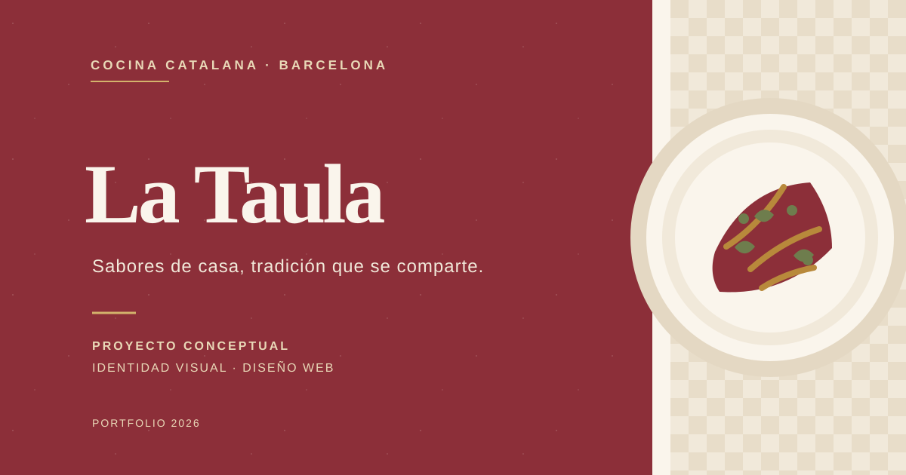

# La Taula



Proyecto conceptual de branding y diseño web para un restaurante ficticio de cocina catalana en Barcelona. Creado como pieza de portfolio para practicar una landing page responsive con una identidad visual cálida y editorial.

## Stack

- HTML5
- CSS3
- Bootstrap 5.3.3
- JavaScript
- Google Fonts: Cormorant Garamond e Inter

## Funcionalidades

- Diseño adaptable a móvil y escritorio.
- Navegación por secciones y menú responsive de Bootstrap.
- Secciones de carta, historia, reseñas de ejemplo y contacto.
- Formulario de reserva de demostración con validación del navegador y confirmación local.

> El restaurante, las reseñas y los datos de contacto son ficticios. El formulario no envía ni almacena solicitudes; no introduzcas datos reales.

## Ver el proyecto

Abre `index.html` en el navegador o sirve la carpeta con un servidor estático:

```bash
python3 -m http.server 8000
```

Después, visita `http://localhost:8000`.
