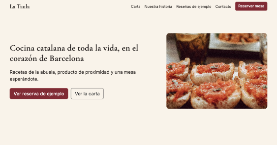

# La Taula



Landing page conceptual para La Taula, un restaurante ficticio de cocina catalana en Barcelona. El proyecto explora cómo trasladar una identidad cálida y editorial a una experiencia web clara, accesible y adaptable a móvil.

**Demo:** [helena-la-taula.vercel.app](https://helena-la-taula.vercel.app)

## Stack

- HTML5 y CSS3.
- Bootstrap 5.3.3 para la cuadrícula, componentes y navegación móvil.
- JavaScript nativo para las interacciones de la demo.
- Cormorant Garamond e Inter, servidas desde Google Fonts.

## Mi trabajo

Diseño e implementación de la página completa: estructura y contenido, sistema visual, estilos responsive, navegación móvil y prototipo del formulario de reserva.

## Decisiones técnicas

- HTML semántico y CSS propio sobre Bootstrap 5.3.3, sin paso de compilación.
- Maquetación responsive y navegación colapsable para móvil.
- Formulario con etiquetas asociadas y validación nativa del navegador; la fecha no permite seleccionar días pasados.
- Accesibilidad: enlace para saltar al contenido, foco visible, texto alternativo y respeto por la preferencia de movimiento reducido.
- Imágenes optimizadas y carga diferida de la fotografía secundaria.
- Metadatos de descripción y vista previa para compartir el enlace.

## Alcance

Es una pieza de portfolio frontend, no un servicio de reservas real. El formulario solo muestra una confirmación local y no envía ni guarda datos; el restaurante, las reseñas, el horario, la dirección y el mapa son ficticios. No introduzcas datos personales.

## Ejecutar en local

Abre `index.html` en el navegador o inicia un servidor estático desde la raíz del proyecto:

```bash
python3 -m http.server 8000
```

Visita `http://localhost:8000`. Bootstrap y las tipografías se cargan desde CDN, por lo que se necesita conexión a internet para esos recursos.
